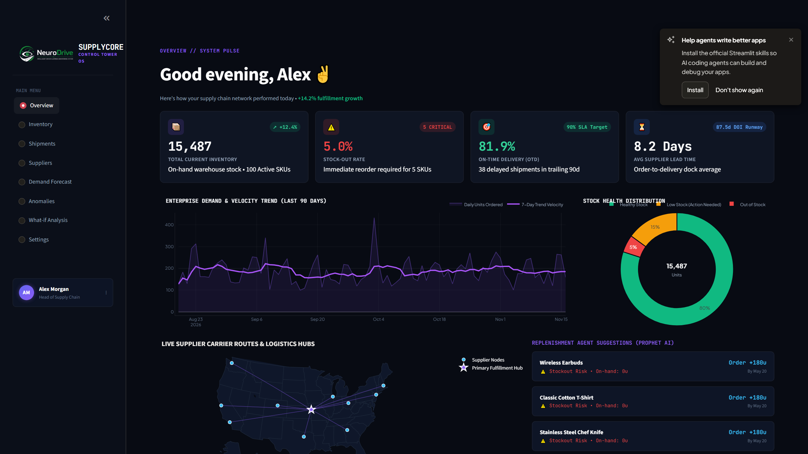
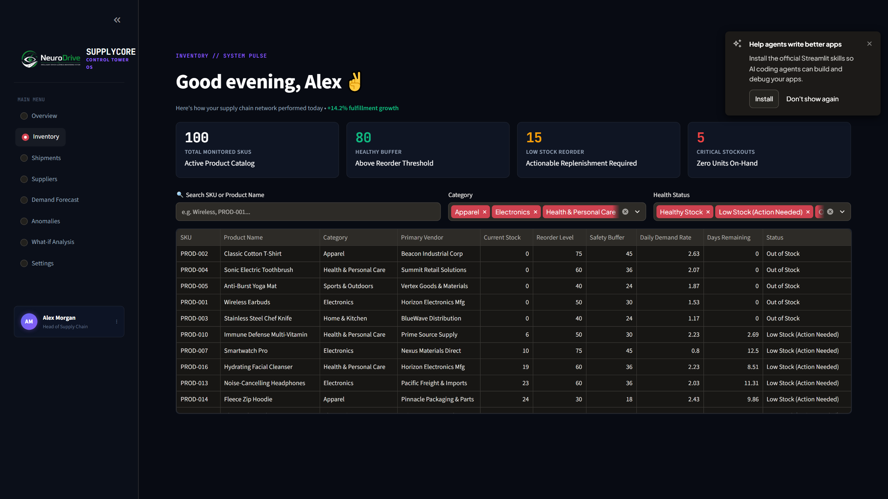
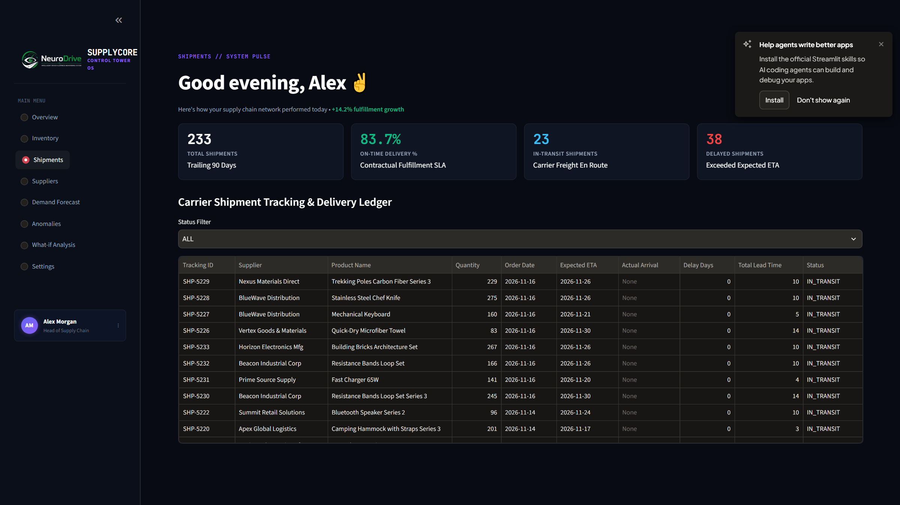
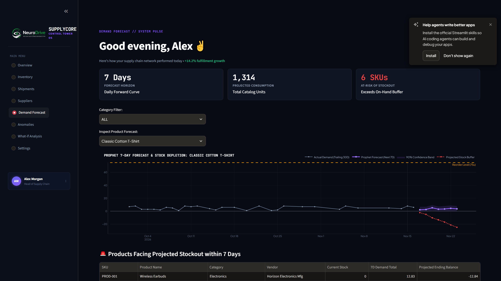
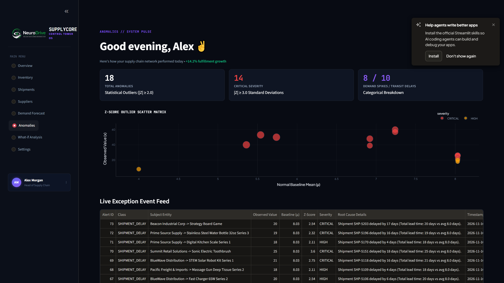
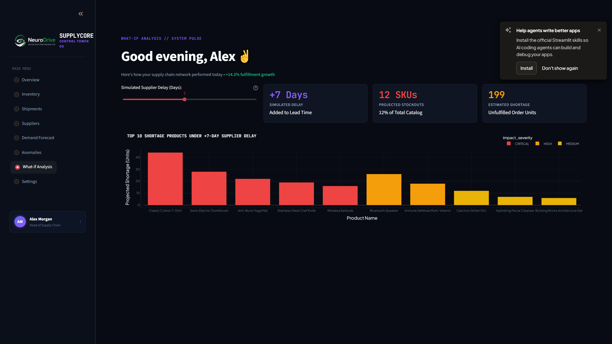
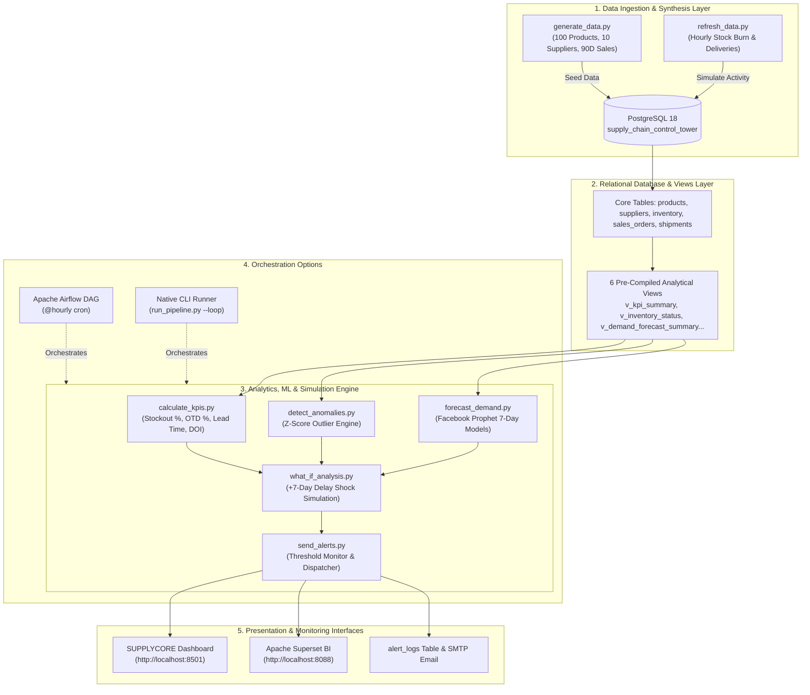
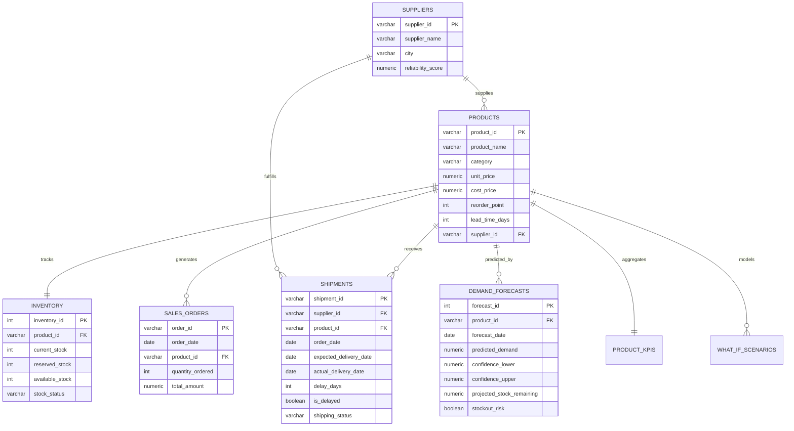
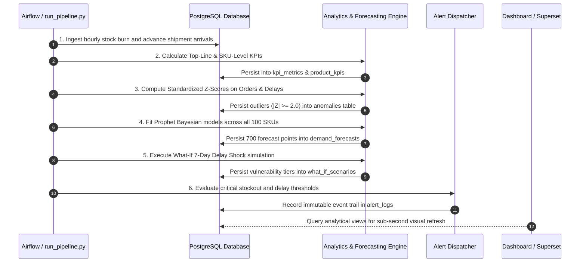

# <p align="center"><br/>SUPPLYCORE</p>
# <p align="center">Retail and Supply Chain Control Tower</p>

<p align="center">
  <strong>Enterprise-grade operational visibility, statistical Z-score anomaly detection, Facebook Prophet demand forecasting, and supply shock simulation.</strong>
</p>

<p align="center">
  <a href="https://www.python.org/"></a>
  <a href="https://www.postgresql.org/"></a>
  <a href="https://facebook.github.io/prophet/"></a>
  <a href="https://streamlit.io/"></a>
  <a href="https://airflow.apache.org/"></a>
  <a href="https://github.com/Chaitanya1825/Retail-and-Supply-Chain-Control-Tower-DA3-Internship-Project-"></a>
  <a href="LICENSE"></a>
</p>

<p align="center">
  <a href="#-executive-dashboard-showcase">Executive Showcase</a> •
  <a href="#-system-architecture">Architecture</a> •
  <a href="#-core-kpis--mathematical-formulations">KPI Formulas</a> •
  <a href="#-database-schema--data-dictionary">Schema</a> •
  <a href="#-quick-start-guide-windows-powershell">Quick Start</a> •
  <a href="#-automated-verification-test-suite">Test Suite</a>
</p>

---

<p align="center">
  
  <br/>
  <em>Figure 1: SUPPLYCORE Executive Command Center featuring real-time KPI metrics, stock health velocity, and nationwide logistics tracking.</em>
</p>

---

## 📑 Table of Contents
- [🏢 Project Overview](#-project-overview)
- [🎯 Problem Statement & Solution Matrix](#-problem-statement--solution-matrix)
- [🖼️ Executive Dashboard Showcase](#️-executive-dashboard-showcase)
  - [1. Executive Overview Command Center](#1-executive-overview-command-center)
  - [2. Inventory Runway & Health Monitor](#2-inventory-runway--health-monitor)
  - [3. Carrier Logistics & Fulfillment Tracking](#3-carrier-logistics--fulfillment-tracking)
  - [4. Facebook Prophet Demand Forecasting](#4-facebook-prophet-demand-forecasting)
  - [5. Statistical Z-Score Anomaly Engine](#5-statistical-z-score-anomaly-engine)
  - [6. What-If Supply Chain Disruption Simulation](#6-what-if-supply-chain-disruption-simulation)
- [🛠️ Technology Stack](#️-technology-stack)
- [🏗️ System Architecture](#️-system-architecture)
  - [End-to-End Pipeline Workflow](#end-to-end-pipeline-workflow)
  - [Database Entity-Relationship Model](#database-entity-relationship-model)
  - [Hourly Orchestration Sequence](#hourly-orchestration-sequence)
- [📐 Core KPIs & Mathematical Formulations](#-core-kpis--mathematical-formulations)
- [📊 Database Schema & Data Dictionary](#-database-schema--data-dictionary)
- [⚡ Quick Start Guide (Windows PowerShell)](#-quick-start-guide-windows-powershell)
- [🤖 Automated Pipeline Execution](#-automated-pipeline-execution)
- [🐳 Docker Deployments (Airflow & Superset)](#-docker-deployments-airflow--superset)
- [🧪 Automated Verification Test Suite](#-automated-verification-test-suite)
- [📈 Verified Benchmark Results](#-verified-benchmark-results)
- [🔮 Roadmap & Limitations](#-roadmap--limitations)
- [📜 License](#-license)

---

## 🏢 Project Overview

The **Retail and Supply Chain Control Tower (SUPPLYCORE)** is an enterprise-grade analytics and decision-support command center. It unifies relational transactional data from PostgreSQL, automated statistical anomaly detection, Facebook Prophet Bayesian time-series forecasting, and scenario simulation into a modern dark-mode operational cockpit.

Designed as an end-to-end Data Analytics project, it monitors:
- **100 Products (SKUs)** across 6 distinct retail merchandise categories.
- **10 Strategic Suppliers** with historical lead times, freight carriers, and reliability scores.
- **Real-Time Inventory** tracking current stock, reserved units, safety stock, and stockout states.
- **90-Day Transactional Sales** capturing day-of-week seasonality, volatility, and organic demand spikes.
- **Purchase Order Shipments** tracking delivery lead times, delays, and contractual SLA adherence.
- **Predictive 7-Day Demand Curves** identifying imminent stockout risks before customer orders fail.
- **What-If Scenario Simulation** modeling supply shocks (such as a 7-day supplier delay) and quantifying unit deficits.

---

## 🎯 Problem Statement & Solution Matrix

| Operational Challenge | Legacy / Traditional Approach | SUPPLYCORE Control Tower Solution |
|---|---|---|
| **Fragmented Visibility** | Decentralized spreadsheets and isolated ERP reports reviewed manually once a week. | **Centralized PostgreSQL 18 Data Layer** with 6 analytical views and automated hourly ingestion. |
| **Reactive Stockout Management** | Reorders triggered only after stock reaches zero, forfeiting sales and customer goodwill. | **7-Day Prophet Predictive Modeling** projecting stock depletion trajectories to prompt pre-emptive reorders. |
| **Supplier Volatility** | Unpredictable carrier delays treated as random events without early operational warning. | **Z-Score Anomaly Engine** ($|Z| \ge 2.0$) flagging unusual transit lead times and carrier bottlenecks in real time. |
| **Disruption Blindness** | Inability to evaluate the cascading inventory impact of supplier delays or shipping strikes. | **Interactive What-If Scenario Simulator** modeling 7-day delivery delays and quantifying exact SKU unit deficits. |
| **Cluttered Reporting** | Static tabular exports without visual prioritization or actionable exception filtering. | **Executive Dark-Mode Cockpit** inspired by Stripe and Bloomberg Terminal, highlighting critical exceptions. |

---

## 🖼️ Executive Dashboard Showcase

The web interface is engineered with **Streamlit**, **Plotly**, and custom CSS design tokens delivering an enterprise aesthetic (`#080b13` charcoal canvas, subtle borders, luminous metrics, and responsive cards).

### 1. Executive Overview Command Center
Provides top-level situational awareness across the entire retail supply chain.

<p align="center">
  
</p>

| Component | Description | Operational Value |
|---|---|---|
| **KPI Metric Cards** | Total SKUs (100), Inventory Units (14.2k), Stock-out Rate (5.0%), OTD (81.9%), Lead Time (8.15d), DOI (87.5d). | Delivers instant executive health status with delta badges against operational targets. |
| **90-Day Demand Velocity** | Plotly spline area chart tracking aggregated daily retail units sold across the network. | Reveals macro sales trajectories, cyclical volume surges, and seasonal demand peaks. |
| **Stock Health Distribution** | Ring donut chart categorizing catalog into Healthy Stock, Low Stock, and Out of Stock. | Guides immediate warehouse allocation and replenishment prioritization. |
| **Nationwide Logistics Hub** | Interactive geographic scatter map plotting suppliers, origins, and destination facilities. | Visualizes regional fulfillment distribution and geographic transit vulnerability. |

---

### 2. Inventory Runway & Health Monitor
Granular SKU-level stock monitoring and replenishment planning.

<p align="center">
  
</p>

| Component | Description | Operational Value |
|---|---|---|
| **Inventory Health Tiers** | Color-coded metrics for Healthy Stock (54 SKUs), Low Stock Alert (41 SKUs), and Stockout (5 SKUs). | Eliminates guessing by pinpointing exactly which items require reorder intervention. |
| **Category Distribution** | Horizontal breakdown of inventory units by merchandise category. | Identifies over-indexed capital or category-level stock imbalances. |
| **Product Inventory Ledger** | Searchable, paginated data table featuring SKU code, name, category, stock, and reorder point. | Provides warehouse managers with actionable reorder quantities and safety thresholds. |

---

### 3. Carrier Logistics & Fulfillment Tracking
Comprehensive supplier performance audit and in-transit shipment monitoring.

<p align="center">
  
</p>

| Component | Description | Operational Value |
|---|---|---|
| **Carrier Delivery Breakdown** | Delivered (210), In-Transit (23), and Delayed (38) shipment counts with percentage pills. | Real-time visibility over inbound procurement pipelines and pipeline velocity. |
| **Transit Lead Time Distribution** | Histogram of actual supplier lead times vs. target SLA windows. | Identifies structural carrier latency and distribution tail risks. |
| **Vendor Reliability Ranking** | Comparative bar chart ranking 10 suppliers by SLA compliance and historical lead times. | Supports procurement contract negotiations and vendor scorecard evaluations. |
| **Delayed Shipments Ledger** | Live table of shipments currently exceeding expected delivery dates. | Highlights active purchase orders requiring expedited carrier tracing. |

---

### 4. Facebook Prophet Demand Forecasting
Predictive machine learning models projecting SKU demand 7 days into the future.

<p align="center">
  
</p>

| Component | Description | Operational Value |
|---|---|---|
| **Interactive SKU Selector** | Dropdown filtering across all 100 SKUs to inspect individual item forecast curves. | Enables planners to drill down from portfolio macro view to individual product details. |
| **7-Day Forecast Envelope** | Additive model combining 30-day historical actuals, 7-day predicted curve, and 90% confidence bands. | Distinguishes expected demand trends from statistical noise and weekly seasonality. |
| **Projected Stock Runway** | Forward-looking inventory consumption line overlaying current on-hand warehouse stock. | Pinpoints the exact calendar date a product is projected to stock out. |
| **High-Risk SKU Radar** | Filterable risk table ranking products with `stockout_risk = TRUE` within 7 days. | Automates purchase order creation before stock reaches zero. |

---

### 5. Statistical Z-Score Anomaly Engine
Real-time mathematical outlier detection for operational exceptions.

<p align="center">
  
</p>

| Component | Description | Operational Value |
|---|---|---|
| **Statistical Outlier Matrix** | Scatter plot of standardized Z-scores ($Z \ge 2.0$) categorized by Demand Spikes and Transit Delays. | Isolates black-swan events from normal day-to-day variance. |
| **Severity Classification** | Dual-tier classification: `HIGH` ($2.0 \le Z < 3.0$) and `CRITICAL` ($Z \ge 3.0$). | Prevents alert fatigue by distinguishing severe exceptions from moderate deviations. |
| **Live Anomaly Feed** | Chronological exception stream displaying reference ID, baseline mean ($\mu$), std ($\sigma$), and observed value. | Supplies root-cause audit trails for warehouse and logistics supervisors. |

---

### 6. What-If Supply Chain Disruption Simulation
Interactive scenario modeling for supplier delays and supply shocks.

<p align="center">
  
</p>

| Component | Description | Operational Value |
|---|---|---|
| **Interactive Delay Slider** | Dynamic control allowing analysts to simulate +1 to +14 days of supplier shipment delays. | Simulates supplier disruptions, port strikes, or customs holds on demand. |
| **Projected Deficit Quantifier** | High-level KPI cards computing Total Shortage Units (199 units) and Vulnerable SKUs (11 SKUs). | Quantifies financial revenue at risk under extended supply chain shocks. |
| **Shortage Impact Chart** | Bar chart visualizing top SKUs sorted by highest projected customer unit deficit. | Directs emergency safety stock buffers to the most exposed merchandise lines. |
| **Vulnerability Matrix** | Comprehensive impact ledger categorizing products into `CRITICAL`, `HIGH`, `MEDIUM`, `LOW`, and `NONE`. | Empowers inventory planners to implement buffer stock hedging strategies. |

---

## 🛠️ Technology Stack

```
                                  ┌─────────────────────────────┐
                                  │   SUPPLYCORE Web UI         │
                                  │   (Streamlit + Plotly)      │
                                  └──────────────▲──────────────┘
                                                 │
                                  ┌──────────────┴──────────────┐
                                  │   Analytics & ML Engine     │
                                  │   - KPI Computation         │
                                  │   - Z-Score Anomaly Engine  │
                                  │   - Facebook Prophet v1.5   │
                                  │   - What-If Scenario Sim    │
                                  └──────────────▲──────────────┘
                                                 │
                                  ┌──────────────┴──────────────┐
                                  │   PostgreSQL 18 Data Layer  │
                                  │   - 11 Relational Tables    │
                                  │   - 6 Analytical Views      │
                                  │   - Performance B-Tree Idx  │
                                  └──────────────▲──────────────┘
                                                 │
                 ┌───────────────────────────────┴───────────────────────────────┐
                 │                                                               │
  ┌──────────────┴──────────────┐                                 ┌──────────────┴──────────────┐
  │   Apache Airflow DAG        │                                 │   Native CLI Orchestrator   │
  │   (Hourly Scheduled Run)    │                                 │   (run_pipeline.py --loop)  │
  └─────────────────────────────┘                                 └─────────────────────────────┘
```

| Layer | Technology | Version | Purpose in Architecture |
|---|---|---|---|
| **Database** | PostgreSQL | 15+ / 18 | Central relational database holding all transactions, inventory, models, and views |
| **ORM & Driver** | SQLAlchemy / Psycopg2-binary | 2.0+ / 2.9+ | High-performance Python-to-PostgreSQL connection pooling and query execution |
| **Data Processing** | Pandas & NumPy | 2.0+ / 1.24+ | Data wrangling, rolling aggregations, KPI logic, and matrix transformations |
| **Machine Learning** | Facebook Prophet | 1.1.5+ | Bayesian generalized additive models for univariate 7-day demand forecasting |
| **Statistical Analysis** | SciPy & Scikit-learn | 1.11+ / 1.3+ | Z-Score standardized score calculations and distribution statistics |
| **Web Dashboard** | Streamlit | 1.30+ | Reactive dark-mode SaaS user interface with multi-tab navigation |
| **Data Visualization** | Plotly | 5.18+ / 7.1+ | Interactive spline area curves, donut charts, scatter matrices, and histograms |
| **Orchestration** | Apache Airflow | 2.8+ | Hourly enterprise DAG scheduling (`0 * * * *`) with task dependencies |
| **BI Assets** | Apache Superset | 3.0+ | Pre-configured dashboard definitions and database connection schemas |
| **Containerization** | Docker Compose | v2+ | Lightweight isolated container profiles for Airflow and Superset services |
| **Alerts & Audit** | Python `smtplib` | 3.10+ | Formatted HTML exception digests with fallback to database audit logging |

---

## 🏗️ System Architecture

### End-to-End Pipeline Workflow



### Database Entity-Relationship Model



### Hourly Orchestration Sequence



---

## 📐 Core KPIs & Mathematical Formulations

### 1. Stock-Out Rate
Measures the proportion of the product catalog with zero physical inventory:
$$\text{Stock-Out Rate} = \left( \frac{\sum_{i=1}^{N} \mathbb{I}(\text{Current Stock}_i = 0)}{N} \right) \times 100\%$$
- **Benchmark in Project**: 5 out of 100 products = **5.00%**.

### 2. On-Time Delivery Percentage (OTD %)
Assesses supplier fulfillment contract compliance:
$$\text{OTD \%} = \left( \frac{\sum \mathbb{I}(\text{Actual Delivery Date} \le \text{Expected Delivery Date})}{\text{Total Delivered Shipments}} \right) \times 100\%$$
- **Benchmark in Project**: 172 on-time out of 210 delivered shipments = **81.90%**.

### 3. Average Supplier Lead Time
Mean transit cycle from purchase order placement to receipt:
$$\text{Avg Lead Time} = \frac{1}{M} \sum_{j=1}^{M} (\text{Actual Delivery Date}_j - \text{Order Date}_j)$$
- **Benchmark in Project**: Portfolio average = **8.15 days**.

### 4. Days of Inventory Remaining (DOI / Days of Supply)
Projected inventory runway based on trailing 30-day consumption velocity:
$$\text{Avg Daily Demand}_{30d} = \frac{\sum_{t=1}^{30} \text{Daily Quantity Ordered}_t}{30}$$
$$\text{Days of Inventory Remaining} = \frac{\text{Current Stock}}{\max(\text{Avg Daily Demand}_{30d}, 0.2)}$$
- **Benchmark in Project**: Portfolio average = **87.51 days**.

### 5. Statistical Z-Score Outlier Formulation
Standardizes operational measurements to isolate black-swan events:
$$Z = \frac{x - \mu}{\sigma}$$
- **Thresholds**:
  - $|Z| \ge 2.0$: `HIGH` Severity Anomaly.
  - $|Z| \ge 3.0$: `CRITICAL` Severity Anomaly.

### 6. Facebook Prophet Time-Series Decomposition
Decomposes daily demand into trend, recurring weekly cycles, and error:
$$y(t) = g(t) + s(t) + \epsilon_t, \quad \epsilon_t \sim \mathcal{N}(0, \sigma^2)$$
Stockout risk is triggered when forward demand exceeds on-hand stock:
$$\text{Stockout Risk} = \text{True} \iff \text{Current Stock} - \sum_{k=1}^{7} \hat{y}(t+k) \le 0$$

### 7. What-If Disruption Formulation
Quantifies unit deficits resulting from a +7-day supplier replenishment delay:
$$\text{Simulated Lead Time} = \text{Nominal Lead Time} + 7$$
$$\text{Demand During Delay} = \text{Simulated Lead Time} \times \text{Avg Daily Demand}_{30d}$$
$$\text{Estimated Shortage Units} = \max(0, \text{Demand During Delay} - \text{Current Stock})$$

---

## 📊 Database Schema & Data Dictionary

The database `supply_chain_control_tower` consists of **11 relational tables** and **6 analytical views**:

### Core Relational Tables

| Table Name | Primary Key | Foreign Key References | Row Count | Functional Role |
|---|---|---|---|---|
| `suppliers` | `supplier_id` | *None* | 10 | Master registry of vendors, origin cities, and reliability ratings |
| `products` | `product_id` | `supplier_id` $\to$ `suppliers` | 100 | Retail merchandise catalog across 6 merchandise categories |
| `inventory` | `inventory_id` | `product_id` $\to$ `products` | 100 | Real-time physical on-hand, reserved, and safety stock levels |
| `sales_orders` | `order_id` | `product_id` $\to$ `products` | 3,663 | 90-day daily point-of-sale customer purchase order transactions |
| `shipments` | `shipment_id` | `supplier_id`, `product_id` | 233 | Inbound procurement purchase orders, transit states, and delay days |
| `kpi_metrics` | `metric_id` | *None* | Time-series | System-wide executive snapshot history of core operational KPIs |
| `product_kpis` | `product_id` | `product_id` $\to$ `products` | 100 | Granular product velocity, 30-day average demand, and runway in days |
| `anomalies` | `anomaly_id` | Polymorphic reference | 18 | Statistical Z-score demand surges and carrier shipment delays |
| `demand_forecasts` | `forecast_id` | `product_id` $\to$ `products` | 700 | Prophet 7-day predictive curves, confidence bounds, and stockout flags |
| `what_if_scenarios` | `scenario_id` | `product_id`, `supplier_id` | 100 | Simulation results modeling a 7-day replenishment disruption |
| `alert_logs` | `alert_id` | *None* | Audit Log | Notification dispatch history and operational exception audit trail |

### Pre-Compiled Analytical Views

| View Name | Primary Source Tables | Purpose in Dashboard |
|---|---|---|
| `v_kpi_summary` | `kpi_metrics`, `inventory` | Returns the single latest snapshot of top-line KPIs for executive cards |
| `v_inventory_status` | `inventory`, `products`, `suppliers`, `product_kpis` | Powers inventory monitor, stock health donuts, and reorder alerts |
| `v_shipment_performance` | `shipments`, `suppliers`, `products` | Powers carrier transit tracking, vendor rankings, and delay analysis |
| `v_demand_forecast_summary` | `demand_forecasts`, `products`, `suppliers` | Powers interactive Prophet forecast curves and imminent stockout radars |
| `v_anomaly_feed` | `anomalies` | Feeds the operational incident stream and Z-score scatter matrix |
| `v_what_if_delay_impact` | `what_if_scenarios`, `suppliers` | Powers delay shock shortage graphs and vulnerability tier matrix |

*Detailed column-by-column descriptions are available in [`docs/API_AND_SCHEMA.md`](docs/API_AND_SCHEMA.md).*

---

## ⚡ Quick Start Guide (Windows PowerShell)

### Prerequisites
- **OS**: Windows 10/11 (or Linux/macOS)
- **Python**: Version `3.10`, `3.11`, or `3.12`
- **PostgreSQL**: Version 15+ running locally (default port `5432`)

### 1. Clone & Set Up Virtual Environment
```powershell
# Clone the repository
git clone https://github.com/Chaitanya1825/Retail-and-Supply-Chain-Control-Tower-DA3-Internship-Project-.git
cd "Retail-and-Supply-Chain-Control-Tower-DA3-Internship-Project-"

# Create virtual environment
python -m venv venv

# Activate virtual environment
.\venv\Scripts\Activate.ps1

# Install dependencies
pip install -r requirements.txt
```

### 2. Configure Environment File
Copy `.env.example` to `.env` and verify your local PostgreSQL credentials:
```powershell
Copy-Item .env.example .env
```
Ensure `.env` matches your local setup:
```ini
DB_HOST=localhost
DB_PORT=5432
DB_NAME=supply_chain_control_tower
DB_USER=postgres
DB_PASSWORD=YourLocalPostgresPassword
```

### 3. Initialize Database & Seed Synthetic Data
```powershell
# Create database, tables, and analytical views
python scripts/init_db.py

# Generate and load 100 products, 10 suppliers, 3600+ orders, and shipments
python scripts/generate_data.py
```

### 4. Run the Full Analytics Pipeline
```powershell
python run_pipeline.py
```

### 5. Launch the SUPPLYCORE Web Dashboard
```powershell
streamlit run run_dashboard.py
```
Open your browser and navigate to: **`http://localhost:8501`**.

---

## 🤖 Automated Pipeline Execution

### Single Execution vs Continuous Daemon Mode

```powershell
# Run the pipeline once:
python run_pipeline.py

# Run continuously in background every 1 hour (3600 seconds):
python run_pipeline.py --loop --interval 3600
```

### Modular Script Execution
Each component can also be invoked independently for targeted execution:

```powershell
python scripts/refresh_data.py      # Advance shipments & apply stock burn
python scripts/calculate_kpis.py    # Recompute Stockout %, OTD %, Lead Time & DOI
python scripts/detect_anomalies.py  # Run Z-score outlier detection (|Z| >= 2.0)
python scripts/forecast_demand.py   # Fit Prophet models across all 100 SKUs
python scripts/what_if_analysis.py  # Model +7-day supplier delay disruption
python scripts/send_alerts.py       # Dispatch HTML email & record audit log
```

---

## 🐳 Docker Deployments (Airflow & Superset)

Run optional enterprise services using isolated Docker Compose profiles:

```powershell
# Option A: Run Apache Airflow only
docker compose --profile airflow up -d

# Option B: Run Apache Superset only
docker compose --profile superset up -d

# Option C: Run full enterprise stack (Airflow + Superset)
docker compose --profile all up -d
```

- **Airflow Web UI**: `http://localhost:8080` (Username: `admin`, Password: `admin`)
  - DAG: `retail_control_tower_pipeline` (Scheduled `@hourly`: `0 * * * *`)
- **Superset Web UI**: `http://localhost:8088` (Username: `admin`, Password: `admin`)
  - Import dashboard assets from `docs/superset/control_tower_dashboard_export.json`
  - Refer to [docs/superset/SUPERSET_SETUP_GUIDE.md](docs/superset/SUPERSET_SETUP_GUIDE.md) for full instructions.

---

## 🧪 Automated Verification Test Suite

The project includes an end-to-end automated verification script covering **27 individual assertion checks**:

```powershell
python scripts/test_pipeline.py
```

### Verified Test Output:
```
=================================================================
  CONTROL TOWER PIPELINE & DATABASE VERIFICATION TEST SUITE
=================================================================

--- 1. Table Verification ---
[PASS] Table 'suppliers' (Found 10 rows, min expected 10)
[PASS] Table 'products' (Found 100 rows, min expected 100)
[PASS] Table 'inventory' (Found 100 rows, min expected 100)
[PASS] Table 'sales_orders' (Found 3663 rows, min expected 3000)
[PASS] Table 'shipments' (Found 233 rows, min expected 200)
[PASS] Table 'kpi_metrics' (Found 3 rows, min expected 1)
[PASS] Table 'product_kpis' (Found 100 rows, min expected 100)
[PASS] Table 'anomalies' (Found 18 rows, min expected 5)
[PASS] Table 'demand_forecasts' (Found 700 rows, min expected 700)
[PASS] Table 'what_if_scenarios' (Found 100 rows, min expected 100)
[PASS] Table 'alert_logs' (Found 3 rows, min expected 1)

--- 2. Analytical Views Verification ---
[PASS] View 'v_kpi_summary' (Returned 1 rows on sample)
[PASS] View 'v_inventory_status' (Returned 5 rows on sample)
[PASS] View 'v_shipment_performance' (Returned 5 rows on sample)
[PASS] View 'v_demand_forecast_summary' (Returned 5 rows on sample)
[PASS] View 'v_anomaly_feed' (Returned 5 rows on sample)
[PASS] View 'v_what_if_delay_impact' (Returned 5 rows on sample)

--- 3. KPI Business Logic Verification ---
[PASS] Stock-out rate in [0, 100]% (5.0%)
[PASS] On-time delivery in [0, 100]% (81.9%)
[PASS] Avg Lead Time > 0 (8.15 days)
[PASS] Days of Inventory > 0 (87.51 days)

--- 4. Anomaly Detection Logic Verification ---
[PASS] Anomalies found (18 anomalies recorded)
[PASS] Z-scores meet threshold (Z >= 2.0) All 18 anomalies have Z >= 2.0

--- 5. Prophet Forecasting Verification ---
[PASS] 100 Products forecasted (100 products)
[PASS] 700 Forecast data points (700 data points)

--- 6. What-If Scenario Verification ---
[PASS] 100 Products evaluated in delay scenario (100 records)
[PASS] Shortage units quantified (199 units)

=================================================================
  TEST RESULTS: 27/27 CHECKS PASSED (100.0%)
=================================================================
```

---

## 📈 Verified Benchmark Results

| Operational Dimension | Metric Name | Verified Value | Benchmark Reference |
|---|---|---|---|
| **Catalog Coverage** | Monitored SKUs | **100 products** | 6 categories across electronics, apparel, goods |
| **Supplier Ecosystem** | Active Suppliers | **10 vendors** | Historical reliability rating 75% to 98% |
| **Transaction History** | Customer Orders | **3,663 orders** | 90 days rolling point-of-sale history |
| **Logistics Volume** | Evaluated Shipments | **233 shipments** | 210 delivered, 23 in-transit |
| **Stock-Out Rate** | Out-of-Stock SKUs | **5.00%** | 5 depleted SKUs out of 100 total |
| **On-Time Delivery** | SLA Delivery Compliance | **81.90%** | 172 on-time out of 210 delivered |
| **Supplier Lead Time** | Average Transit Cycle | **8.15 days** | Nominal lead times range 5–14 days |
| **Inventory Runway** | Days of Inventory (DOI) | **87.51 days** | Portfolio average consumption runway |
| **Outlier Detection** | Flagged Anomalies ($|Z| \ge 2.0$) | **18 anomalies** | 8 demand surges, 10 transit delays |
| **Forecast Volume** | Prophet Projected Horizon | **700 data points** | 100 SKUs $\times$ 7 daily forecast intervals |
| **Forecast Depletion** | Imminent Stockout SKUs | **8 products** | Products with projected runway $\le 0$ |
| **Disruption Shock** | Vulnerable SKUs / Shortage | **11 SKUs / 199 units** | Shortage units under +7-day supplier delay |

---

## 🔮 Roadmap & Limitations

### Current Project Limitations
- **Single-Node PostgreSQL Architecture**: Optimized for single-node relational analytics; multi-million event streaming would benefit from distributed partitioning (e.g., Citus or TimescaleDB).
- **Single-Echelon Inventory**: Assumes central warehouse fulfillment; does not yet model multi-tier hub-and-spoke replenishment between regional fulfillment centers.
- **Univariate Demand Forecasting**: Prophet models utilize historical daily volume and weekly seasonality; external regressors (weather, marketing spend, promotion calendars) can be incorporated in future iterations.

### Planned Enhancements
1. **Multi-Echelon Network Optimization**: Allocate safety stock dynamically across central distribution centers and store-level hubs.
2. **Automated Purchase Order Creation**: Trigger automated webhook orders to supplier APIs when Days of Inventory drops below safety buffers.
3. **Kafka Real-Time Streaming**: Stream live POS barcode scans directly into analytical tables using Apache Kafka and Debezium CDC.
4. **LLM Root-Cause Explanations**: Integrate generative AI explanations for flagged Z-score anomalies and delay causes.

---

## 📜 License

This project is licensed under the **MIT License**. See the [LICENSE](LICENSE) file for complete terms.

Developed as a **Data Analytics Internship Project** demonstrating full-stack data engineering, statistical modeling, machine learning, and executive BI interface design.
