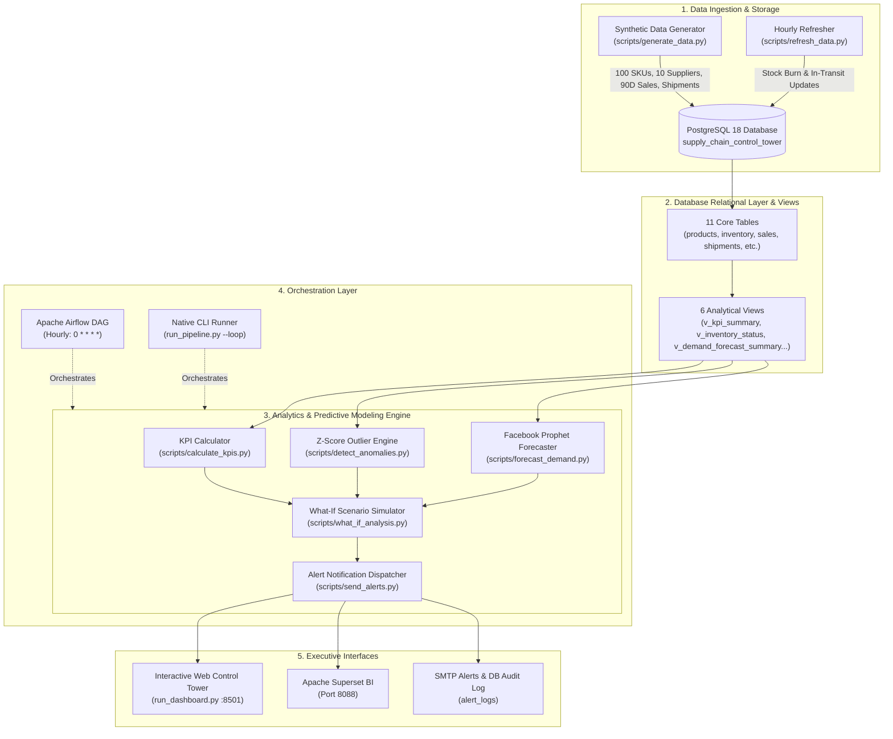

# 🏢 Retail and Supply Chain Control Tower

> **Data Analytics Internship Project**  
> An enterprise-grade, end-to-end retail supply chain command center featuring automated hourly data ingestion, statistical anomaly detection, Facebook Prophet predictive demand forecasting, 7-day supplier disruption simulation, and executive decision-support dashboards.

[](https://www.python.org/)
[](https://www.postgresql.org/)
[](https://facebook.github.io/prophet/)
[](https://airflow.apache.org/)
[](https://streamlit.io/)
[-success.svg)](scripts/test_pipeline.py)
[](LICENSE)

---

## 📑 Table of Contents
1. [Overview](#1-overview)
2. [Problem Statement](#2-problem-statement)
3. [Key Features](#3-key-features)
4. [Technology Stack](#4-technology-stack)
5. [System Architecture](#5-system-architecture)
6. [Project Folder Structure](#6-project-folder-structure)
7. [Database Schema Overview](#7-database-schema-overview)
8. [KPI Definitions & Formulas](#8-kpi-definitions--formulas)
9. [Anomaly Detection Methodology](#9-anomaly-detection-methodology)
10. [Facebook Prophet Forecasting Methodology](#10-facebook-prophet-forecasting-methodology)
11. [Seven-Day Supplier Delay Simulation](#11-seven-day-supplier-delay-simulation)
12. [Dashboard Screenshots & Visual Interface](#12-dashboard-screenshots--visual-interface)
13. [Installation Instructions (Windows PowerShell)](#13-installation-instructions-windows-powershell)
14. [PostgreSQL Setup Instructions](#14-postgresql-setup-instructions)
15. [Environment Configuration](#15-environment-configuration)
16. [How to Generate Synthetic Data](#16-how-to-generate-synthetic-data)
17. [How to Run the Analytics Pipeline](#17-how-to-run-the-analytics-pipeline)
18. [How to Launch the Dashboard](#18-how-to-launch-the-dashboard)
19. [How to Configure Apache Airflow](#19-how-to-configure-apache-airflow)
20. [How to Configure Apache Superset](#20-how-to-configure-apache-superset)
21. [Email Alert Configuration](#21-email-alert-configuration)
22. [Testing & Verification](#22-testing--verification)
23. [Sample Results from Actual Execution](#23-sample-results-from-actual-execution)
24. [Limitations & Future Improvements](#24-limitations--future-improvements)
25. [License](#25-license)

---

## 1. Overview
Modern retail and omnichannel fulfillment networks operate under razor-thin inventory margins and unpredictable supplier delivery lead times. The **Retail and Supply Chain Control Tower** centralizes end-to-end operational visibility across 100 SKUs and 10 regional suppliers. By combining relational storage in PostgreSQL, statistical Z-score outlier detection, Facebook Prophet time-series models, and interactive scenario simulation, the Control Tower empowers supply chain analysts to identify stockout risks before they disrupt business operations.

---

## 2. Problem Statement
Retail organizations frequently encounter critical supply chain blind spots:
- **Fragmented Visibility**: Inventory levels, supplier purchase orders, and sales velocities reside in disconnected databases or spreadsheets.
- **Reactive Stockout Management**: Reorder decisions occur after inventory has depleted, forfeiting revenue and impairing customer satisfaction.
- **Supplier Volatility**: Unpredictable supplier transit times cause stock-outs or excessive holding costs without early warning.
- **Inadequate Scenario Planning**: Supply chain teams lack automated mechanisms to evaluate how supplier delays compound over rolling sales periods.

The Control Tower addresses these challenges by transforming raw transaction data into proactive, actionable operational intelligence.

---

## 3. Key Features
- **Hourly Automated Ingestion**: Updates inventory deductions and tracks shipments continuously.
- **Top-Line Supply Chain KPIs**: Automatically calculates Stock-Out Rate, On-Time Delivery Percentage (OTD %), Average Supplier Lead Time, and Days of Inventory (DOI).
- **Statistical Z-Score Anomaly Engine**: Identifies unusual demand surges and transit delay outliers ($|Z| \ge 2.0$) with zero reliance on paid external APIs.
- **Facebook Prophet Predictive Modeling**: Fits Bayesian additive time-series models across all 100 SKUs, projecting 7-day future demand curves and identifying imminent stockout hazards.
- **What-If Disruption Simulation**: Models an unexpected 7-day supplier delay, quantifying projected unit deficits and classifying SKU vulnerability.
- **Dual Orchestration**: Ships with an Apache Airflow DAG (`@hourly`) for enterprise pipelines and a standalone native CLI runner (`run_pipeline.py`) for lightweight execution.
- **Enterprise Executive Dashboard**: Built with Streamlit and Plotly, delivering dark-mode analytics inspired by modern SaaS interfaces (Linear, Stripe, Bloomberg Terminal).
- **Automated Alerts**: Generates HTML and plaintext notification digests via standard SMTP with fallback to database audit tables (`alert_logs`).

---

## 4. Technology Stack

| Category | Technologies | Purpose |
|---|---|---|
| **Database Platform** | PostgreSQL 15+, SQLAlchemy 2.0, Psycopg2-binary | Relational schema, indices, transactional persistence & analytical views |
| **Data Analytics** | Python 3.10+, Pandas 2.0+, NumPy | Data transformation, aggregation, KPI calculations & pipeline logic |
| **Machine Learning** | Facebook Prophet 1.1+, SciPy, Scikit-learn | Time-series decomposition, weekly seasonality & Z-score anomaly detection |
| **Orchestration** | Apache Airflow 2.8+ / Native Python Daemon | Hourly pipeline orchestration and automated batch DAG execution |
| **User Interface & BI** | Streamlit, Plotly Express & Graph Objects, Apache Superset | Interactive executive dashboard, chart components & BI asset definitions |
| **Infrastructure** | Docker, Docker Compose, Windows PowerShell | Containerized services, isolated profiles and native Windows scripts |
| **Notifications** | Python `smtplib`, `email.mime` | Automated email digests and database audit trail logging |

---

## 5. System Architecture



---

## 6. Project Folder Structure

```
Retail and Supply Chain Control Tower/
├── assets/
│   └── logo.png                          # Brand asset for executive dashboard
├── config/
│   ├── __init__.py
│   └── settings.py                       # Environment loader & database connection factory
├── dags/
│   └── retail_control_tower_dag.py       # Apache Airflow hourly DAG
├── data/                                 # Exported CSV backups of synthetic records
│   ├── inventory.csv
│   ├── products.csv
│   ├── sales_orders.csv
│   ├── shipments.csv
│   └── suppliers.csv
├── docs/
│   ├── API_AND_SCHEMA.md                 # Complete database data dictionary & view definitions
│   ├── ARCHITECTURE.md                   # System architecture & mathematical formulations
│   ├── INTERNSHIP_REPORT.md              # Comprehensive internship project summary report
│   ├── POWERSHELL_GUIDE.md               # Step-by-step Windows PowerShell execution guide
│   ├── screenshots/
│   │   └── README.md                     # Screenshot capture guide and layout checklist
│   └── superset/
│       ├── control_tower_dashboard_export.json # 10-chart Superset dashboard config
│       ├── superset_database_connection.json   # Superset database connection payload
│       └── SUPERSET_SETUP_GUIDE.md             # Step-by-step Superset connection manual
├── scripts/
│   ├── calculate_kpis.py                 # Computes Stock-out rate, OTD %, Lead time, DOI
│   ├── detect_anomalies.py               # Z-score outlier detection (|Z| >= 2.0)
│   ├── forecast_demand.py                # Facebook Prophet 7-day demand forecasting
│   ├── generate_data.py                  # Generates realistic synthetic retail data
│   ├── init_db.py                        # Creates PostgreSQL database, tables, and views
│   ├── refresh_data.py                   # Hourly simulation of stock burn & shipment delivery
│   ├── send_alerts.py                    # Evaluates thresholds & dispatches SMTP/DB alerts
│   ├── superset_assets.py                # Exports Apache Superset configuration assets
│   ├── test_pipeline.py                  # End-to-end 27-check verification test suite
│   └── what_if_analysis.py               # Simulates 7-day supplier replenishment delay
├── sql/
│   ├── schema.sql                        # PostgreSQL DDL table definitions (11 tables)
│   └── views.sql                         # Analytical views optimized for dashboards (6 views)
├── .env.example                          # Sanitized environment variable configuration template
├── .gitignore                            # Excludes credentials, caches, virtual environments
├── docker-compose.yml                    # Containerized profiles for Airflow and Superset
├── README.md                             # Repository master documentation
├── requirements.txt                      # Production Python package dependencies
├── run.ps1                               # Interactive Windows PowerShell launch menu
├── run_dashboard.py                      # Enterprise Control Tower web dashboard (Streamlit)
└── run_pipeline.py                       # Single-command pipeline CLI runner
```

---

## 7. Database Schema Overview

The database `supply_chain_control_tower` is structured into **11 relational tables** and **6 analytical views**:

| Table | Primary Key | Description | Verified Count |
|---|---|---|---|
| `suppliers` | `supplier_id` | Regional suppliers with reliability ratings | 10 records |
| `products` | `product_id` | Retail catalog across 6 merchandise categories | 100 records |
| `inventory` | `inventory_id` | On-hand, reserved, and available stock levels | 100 records |
| `sales_orders` | `order_id` | 90-day daily point-of-sale customer orders | 3,663 records |
| `shipments` | `shipment_id` | Purchase order tracking, transit states, and delays | 233 records |
| `kpi_metrics` | `metric_id` | System-wide executive snapshot history | Time-series |
| `product_kpis` | `product_id` | SKU-level 30-day demand and runway in days | 100 records |
| `anomalies` | `anomaly_id` | Standardized Z-Score statistical outliers | 18 records |
| `demand_forecasts` | `forecast_id` | 7-day Prophet forecast curves & stockout flags | 700 records |
| `what_if_scenarios` | `scenario_id` | +7-day supplier delay simulation shortage results | 100 records |
| `alert_logs` | `alert_id` | Notification dispatch and audit logging ledger | Dynamic |

*For complete column-level definitions, constraints, and data types, refer to [docs/API_AND_SCHEMA.md](docs/API_AND_SCHEMA.md).*

---

## 8. KPI Definitions & Formulas

### 8.1 Stock-Out Rate
Quantifies the percentage of the product catalog currently unavailable to fulfill customer orders:
$$\text{Stock-Out Rate} = \left( \frac{\sum_{i=1}^{N} \mathbb{I}(\text{Current Stock}_i = 0)}{N} \right) \times 100\%$$
- **Verified Benchmark**: 5 depleted SKUs out of 100 = **5.00%**.

### 8.2 On-Time Delivery Percentage (OTD %)
Evaluates supplier contract fulfillment reliability:
$$\text{OTD \%} = \left( \frac{\sum \mathbb{I}(\text{Actual Delivery Date} \le \text{Expected Delivery Date})}{\text{Total Delivered Shipments}} \right) \times 100\%$$
- **Verified Benchmark**: 172 on-time out of 210 delivered shipments = **81.90%**.

### 8.3 Average Supplier Lead Time
Measures the average duration in calendar days from purchase order placement to receipt:
$$\text{Avg Lead Time} = \frac{1}{M} \sum_{j=1}^{M} (\text{Actual Delivery Date}_j - \text{Order Date}_j)$$
- **Verified Benchmark**: Portfolio average = **8.15 days**.

### 8.4 Days of Inventory Remaining (DOI / Days of Supply)
Calculates available warehouse inventory runway based on trailing 30-day average daily sales velocity:
$$\text{Avg Daily Demand}_{30d} = \frac{\sum_{t=1}^{30} \text{Daily Quantity Ordered}_t}{30}$$
$$\text{Days of Inventory Remaining} = \frac{\text{Current Stock}}{\max(\text{Avg Daily Demand}_{30d}, 0.2)}$$
- **Verified Benchmark**: Portfolio average = **87.51 days**.

---

## 9. Anomaly Detection Methodology

The anomaly detection engine (`scripts/detect_anomalies.py`) implements statistical standard score ($Z$-Score) analysis to flag operational deviations without black-box machine learning dependencies:

$$Z = \frac{x - \mu}{\sigma}$$

Where:
- $x$: Observed daily metric (daily product sales quantity or shipment lead time).
- $\mu$: Historical baseline mean over evaluated period.
- $\sigma$: Historical baseline standard deviation.

### Evaluation Criteria:
1. **Demand Spikes**: Daily product order volume where $Z \ge 2.0$.
2. **Shipment Delays**: Supplier delivery lead time exceeding baseline distributions ($Z \ge 2.0$).
3. **Severity Classification**:
   - **CRITICAL**: $Z \ge 3.0$ (Outliers beyond 99.7% of the normal distribution).
   - **HIGH**: $2.0 \le Z < 3.0$ (Significant deviations requiring operational attention).

---

## 10. Facebook Prophet Forecasting Methodology

The predictive engine (`scripts/forecast_demand.py`) fits Bayesian generalized additive time-series models across all 100 SKUs independently using Facebook Prophet:

$$y(t) = g(t) + s(t) + \epsilon_t, \quad \epsilon_t \sim \mathcal{N}(0, \sigma^2)$$

- **Trend $g(t)$**: Piecewise linear trend capturing long-term volume trajectory.
- **Seasonality $s(t)$**: Fourier series modeling recurring 7-day weekly consumer purchasing cycles.
- **Error $\epsilon_t$**: Gaussian noise parameter.

### Stockout Risk Identification:
For each product, the cumulative predicted demand over the forward 7-day window is compared against on-hand stock:
$$\text{Stockout Risk} = \text{True} \iff \text{Current Stock} - \sum_{k=1}^{7} \hat{y}(t+k) \le 0$$
When projected stock reaches zero, the SKU is flagged with `stockout_risk = TRUE` to initiate immediate replenishment.

---

## 11. Seven-Day Supplier Delay Simulation

The What-If scenario engine (`scripts/what_if_analysis.py`) simulates a supply shock where inbound supplier deliveries are delayed by **7 calendar days**:

$$\text{Simulated Lead Time} = \text{Nominal Lead Time} + 7$$
$$\text{Demand During Delay} = \text{Simulated Lead Time} \times \text{Avg Daily Demand}_{30d}$$
$$\text{Projected Balance} = \text{Current Stock} - \text{Demand During Delay}$$
$$\text{Estimated Shortage Units} = \max(0, -\text{Projected Balance})$$

### Vulnerability Tiers:
- **CRITICAL**: Current stock is zero or immediate stockout within 48 hours.
- **HIGH**: Stockout projected with unit shortage $\ge 50$ units.
- **MEDIUM**: Stockout projected with unit shortage $< 50$ units.
- **LOW**: Inventory reaches reorder threshold but remains positive.
- **NONE**: Adequate safety buffer to absorb the 7-day shock.

---

## 12. Dashboard Screenshots & Visual Interface

The web interface is organized into **6 core operational views**:

| View | Purpose & Components |
|---|---|
| **Overview** | Top KPI cards, 90-day demand velocity curve, stock health ratio donut chart, and live US logistics origin map. |
| **Inventory** | Stock health metrics (Healthy, Low Stock, Stockouts), SKU filter toolbar, and full catalog inventory ledger. |
| **Shipments** | Carrier performance metrics, lead time histogram distribution, and delayed shipment tracking table. |
| **Demand Forecast** | Interactive SKU forecast curves displaying 30-day historical sales, 7-day Prophet predictions, and 90% confidence bands. |
| **Anomalies** | Z-Score outlier scatter matrix ($|Z| \ge 2.0$), severity filters, and real-time operational incident feed. |
| **What-If Analysis** | Interactive 7-day delay slider, affected SKU count, unit shortage bar chart, and vulnerability matrix. |

> **Screenshot Capture Instructions**: Refer to [docs/screenshots/README.md](docs/screenshots/README.md) for step-by-step guidance on capturing high-resolution PNG screenshots.

---

## 13. Installation Instructions (Windows PowerShell)

### Prerequisites:
- Windows 10/11
- Python 3.10 or higher
- PostgreSQL 15+ installed and running locally

### Step-by-Step Setup:
```powershell
# 1. Clone repository
git clone https://github.com/your-username/retail-supply-chain-control-tower.git
cd "retail-supply-chain-control-tower"

# 2. Create Python virtual environment
python -m venv venv

# 3. Activate virtual environment
.\venv\Scripts\Activate.ps1

# 4. Install required dependencies
pip install -r requirements.txt
```

---

## 14. PostgreSQL Setup Instructions

1. Ensure the PostgreSQL service is active in Windows Services (`services.msc`) or via PowerShell:
   ```powershell
   Get-Service -Name postgresql*
   ```
2. Verify that PostgreSQL is accessible on port `5432` with your administrative user (`postgres`).
3. The initialization script (`scripts/init_db.py`) will automatically create the database `supply_chain_control_tower` if it does not already exist.

---

## 15. Environment Configuration

1. Create your local `.env` file from the sanitized template:
   ```powershell
   Copy-Item .env.example .env
   ```
2. Open `.env` and specify your local database password and optional SMTP settings:
   ```ini
   # Database Configuration
   DB_HOST=localhost
   DB_PORT=5432
   DB_NAME=supply_chain_control_tower
   DB_USER=postgres
   DB_PASSWORD=YourSecurePasswordHere

   # Email Alert Configuration (Optional)
   ENABLE_EMAIL_ALERTS=false
   SMTP_HOST=smtp.gmail.com
   SMTP_PORT=587
   SMTP_USER=
   SMTP_PASSWORD=
   ALERT_RECIPIENT_EMAIL=supplychain_alerts@example.com

   # Analytical Parameters
   PROPHET_FORECAST_HORIZON_DAYS=7
   DELAY_SIMULATION_DAYS=7
   ```

---

## 16. How to Generate Synthetic Data

Execute the database initialization and data generator to synthesize 10 suppliers, 100 products, inventory buffers, 90 days of customer transactions, and inbound shipments:

```powershell
# Step 1: Create database, schema tables, and analytical views
python scripts/init_db.py

# Step 2: Generate realistic supply chain records and load into PostgreSQL
python scripts/generate_data.py
```

*Data generation also saves CSV backups to the `data/` folder.*

---

## 17. How to Run the Analytics Pipeline

### Single-Run Execution:
Run the complete pipeline end-to-end (KPI calculation $\to$ anomaly detection $\to$ Prophet forecasting $\to$ what-if analysis $\to$ alerts):
```powershell
python run_pipeline.py
```

### Continuous Daemon Mode (Hourly):
Run the pipeline continuously in the background to simulate automated hourly updates on Windows:
```powershell
python run_pipeline.py --loop --interval 3600
```

---

## 18. How to Launch the Dashboard

Launch the interactive Control Tower dashboard:
```powershell
streamlit run run_dashboard.py
```
Open your browser and navigate to: **`http://localhost:8501`**.

---

## 19. How to Configure Apache Airflow

For containerized environments, an Apache Airflow DAG is provided in `dags/retail_control_tower_dag.py`:

```powershell
# Start Airflow container services
docker compose --profile airflow up -d
```
1. Open the Airflow Web UI at `http://localhost:8080` (Username: `admin`, Password: `admin`).
2. Locate the DAG `retail_control_tower_pipeline`.
3. Toggle the DAG switch to **Active**. The DAG executes on an hourly cron schedule (`0 * * * *`).

---

## 20. How to Configure Apache Superset

Pre-built Superset assets are included in `docs/superset/`:

```powershell
# Start Superset container services
docker compose --profile superset up -d
```
1. Access Superset at `http://localhost:8088` (Username: `admin`, Password: `admin`).
2. Add Database Connection: Set SQLAlchemy URI to `postgresql://postgres:<your_password>@host.docker.internal:5432/supply_chain_control_tower`.
3. Import Dashboard: Navigate to **Dashboards $\to$ Import** and upload `docs/superset/control_tower_dashboard_export.json`.
4. Detailed setup steps are documented in [docs/superset/SUPERSET_SETUP_GUIDE.md](docs/superset/SUPERSET_SETUP_GUIDE.md).

---

## 21. Email Alert Configuration

The alerting engine (`scripts/send_alerts.py`) evaluates critical exceptions after each pipeline run:
- **Condition 1**: Critical stock depletion (`current_stock == 0` or days of supply $\le 2.0$).
- **Condition 2**: Severe shipment delays ($\ge 5$ days past SLA delivery date).

If `ENABLE_EMAIL_ALERTS=true` and valid SMTP credentials are provided, a formatted HTML email digest is dispatched. In all configurations, alerts are safely logged into the database table `alert_logs` for an immutable audit trail.

---

## 22. Testing & Verification

The repository includes a comprehensive 27-check automated test suite validating tables, views, business logic, Z-score thresholds, Prophet outputs, and scenario simulations:

```powershell
python scripts/test_pipeline.py
```

### Verified Test Results:
```
=================================================================
  CONTROL TOWER PIPELINE & DATABASE VERIFICATION TEST SUITE
=================================================================

--- 1. Table Verification ---
[PASS] Table 'suppliers' (Found 10 rows, min expected 10)
[PASS] Table 'products' (Found 100 rows, min expected 100)
[PASS] Table 'inventory' (Found 100 rows, min expected 100)
[PASS] Table 'sales_orders' (Found 3663 rows, min expected 3000)
[PASS] Table 'shipments' (Found 233 rows, min expected 200)
[PASS] Table 'kpi_metrics' (Found 3 rows, min expected 1)
[PASS] Table 'product_kpis' (Found 100 rows, min expected 100)
[PASS] Table 'anomalies' (Found 18 rows, min expected 5)
[PASS] Table 'demand_forecasts' (Found 700 rows, min expected 700)
[PASS] Table 'what_if_scenarios' (Found 100 rows, min expected 100)
[PASS] Table 'alert_logs' (Found 3 rows, min expected 1)

--- 2. Analytical Views Verification ---
[PASS] View 'v_kpi_summary' (Returned 1 rows on sample)
[PASS] View 'v_inventory_status' (Returned 5 rows on sample)
[PASS] View 'v_shipment_performance' (Returned 5 rows on sample)
[PASS] View 'v_demand_forecast_summary' (Returned 5 rows on sample)
[PASS] View 'v_anomaly_feed' (Returned 5 rows on sample)
[PASS] View 'v_what_if_delay_impact' (Returned 5 rows on sample)

--- 3. KPI Business Logic Verification ---
[PASS] Stock-out rate in [0, 100]% (5.0%)
[PASS] On-time delivery in [0, 100]% (81.9%)
[PASS] Avg Lead Time > 0 (8.15 days)
[PASS] Days of Inventory > 0 (87.51 days)

--- 4. Anomaly Detection Logic Verification ---
[PASS] Anomalies found (18 anomalies recorded)
[PASS] Z-scores meet threshold (Z >= 2.0) All 18 anomalies have Z >= 2.0

--- 5. Prophet Forecasting Verification ---
[PASS] 100 Products forecasted (100 products)
[PASS] 700 Forecast data points (700 data points)

--- 6. What-If Scenario Verification ---
[PASS] 100 Products evaluated in delay scenario (100 records)
[PASS] Shortage units quantified (199 units)

=================================================================
  TEST RESULTS: 27/27 CHECKS PASSED (100.0%)
=================================================================
```

---

## 23. Sample Results from Actual Execution

| Dimension | Metric | Observed Project Value |
|---|---|---|
| **Catalog Scope** | Total Monitored SKUs | 100 products across 6 categories |
| **Supplier Network** | Registered Suppliers | 10 regional vendors |
| **Transaction History** | Point-of-Sale Orders | 3,663 orders over 90 days |
| **Inbound Logistics** | Evaluated Shipments | 233 shipments (210 delivered, 23 in-transit) |
| **Stock-Out Rate** | Out-of-Stock SKUs | 5.00% (5 products) |
| **On-Time Delivery** | SLA Delivery Rate | 81.90% |
| **Supplier Lead Time** | Mean Transit Cycle | 8.15 days |
| **Inventory Runway** | Days of Inventory (DOI) | 87.51 days portfolio average |
| **Anomaly Detection** | Statistical Outliers ($|Z| \ge 2.0$) | 18 anomalies (8 demand spikes, 10 shipment delays) |
| **Prophet Forecast** | 7-Day Predicted Data Points | 700 predictions (100 SKUs $\times$ 7 days) |
| **Forecast Stockout Risk** | Imminent Depletion SKUs | 8 SKUs at risk within 7 days |
| **7-Day Delay Shock** | Vulnerable SKUs / Shortage | 11 SKUs at risk, 199 total deficit units |

---

## 24. Limitations & Future Improvements

### Limitations:
- **Single-Node PostgreSQL**: Optimized for single-node relational workloads; high-throughput streaming environments would benefit from distributed partitioning.
- **Single-Echelon Inventory**: Assumes central warehouse replenishment rather than a multi-tier distribution network (hub-and-spoke).
- **Univariate Forecasting**: Current Prophet models utilize daily transaction history without external covariates (promotions, weather, macroeconomic factors).

### Future Roadmap:
1. **Multi-Echelon Optimization**: Model inventory allocation across central distribution centers and retail storefronts.
2. **Exogenous Regressors**: Integrate promotional calendars and price elasticity into Prophet forecasting models.
3. **Automated Purchase Orders**: Implement automated PO creation via webhook triggers when DOI drops below reorder thresholds.
4. **Real-Time Streaming**: Stream point-of-sale transactions via Apache Kafka into ClickHouse or PostgreSQL.

---

## 25. License

This project is licensed under the **MIT License**. See the [LICENSE](LICENSE) file for details.

Developed as a Data Analytics Internship Project.
