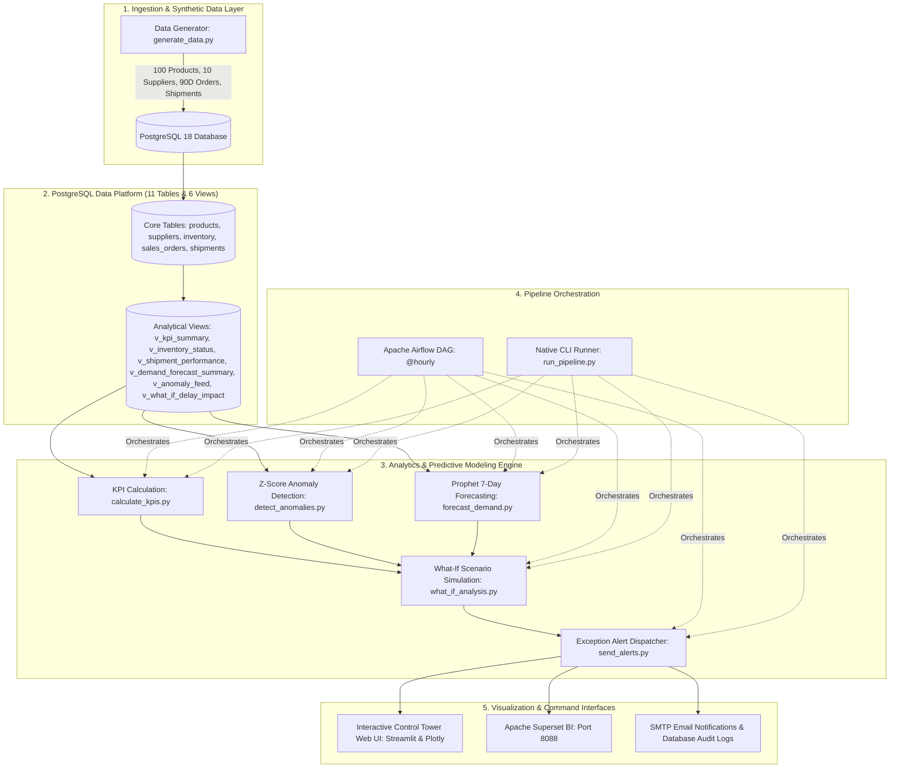
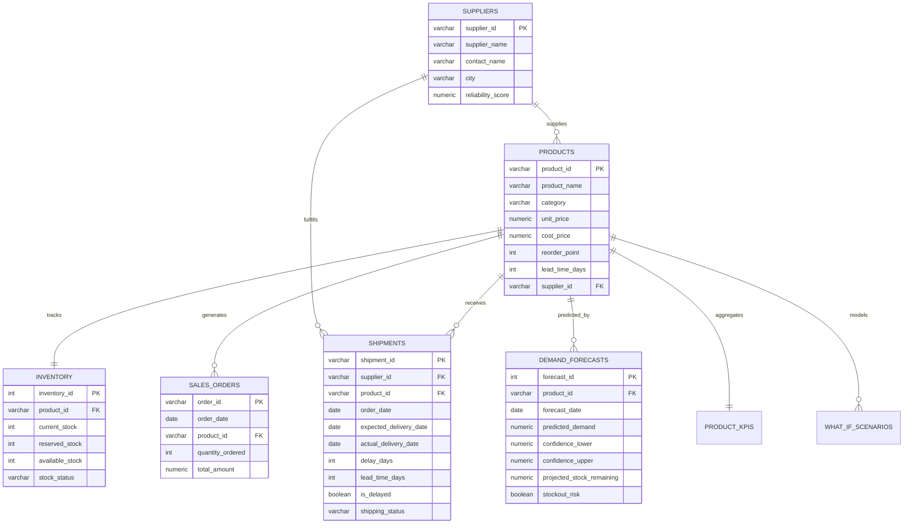
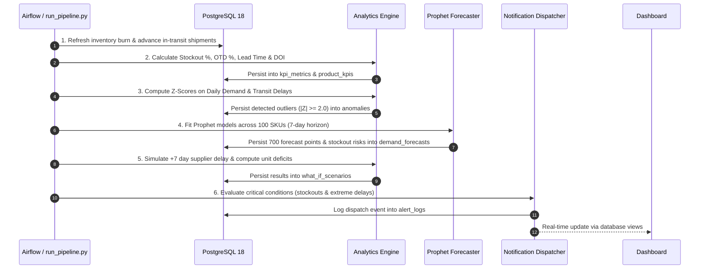

# System Architecture & Technical Design

## 1. Executive Overview

The **Retail & Supply Chain Control Tower** is an enterprise-grade analytics platform that unifies relational transactional data, statistical anomaly detection, Facebook Prophet time-series forecasting, and scenario simulation into an integrated operational command center.

---

## 2. End-to-End System Architecture

---

## 3. Database Entity-Relationship (ER) Architecture

---

## 4. Pipeline Execution Sequence

---

## 5. Mathematical Formulations

### 5.1 Stock-Out Rate
Measures the percentage of catalog SKUs unable to fulfill customer orders due to zero stock:
$$\text{Stock-Out Rate} = \left( \frac{\sum_{i=1}^{N} \mathbb{I}(\text{Current Stock}_i = 0)}{N} \right) \times 100\%$$
- **Benchmark in Project**: 5 out of 100 products = **5.0%**.

### 5.2 On-Time Delivery Percentage (OTD %)
Evaluates supplier fulfillment reliability:
$$\text{OTD \%} = \left( \frac{\text{Shipments where Actual Delivery Date} \le \text{Expected Delivery Date}}{\text{Total Evaluated Shipments}} \right) \times 100\%$$
- **Benchmark in Project**: 169 on-time out of 207 delivered shipments = **81.6%**.

### 5.3 Days of Inventory Remaining (DOI / Days of Supply)
Computes stock runway based on the trailing 30-day consumption velocity:
$$\text{Avg Daily Demand}_{30d} = \frac{\sum_{t=1}^{30} \text{Daily Quantity Ordered}_t}{30}$$
$$\text{Days of Inventory Remaining} = \frac{\text{Current Stock}}{\max(\text{Avg Daily Demand}_{30d}, 0.2)}$$
- **Benchmark in Project**: Portfolio average = **87.5 days**.

### 5.4 Statistical Z-Score Anomaly Detection
Standardizes deviations from baseline distributions to isolate operational outliers:
$$Z = \frac{x - \mu}{\sigma}$$
- **Thresholds**:
  - $|Z| \ge 2.0$: High Severity Alert
  - $|Z| \ge 3.0$: Critical Severity Alert

### 5.5 Facebook Prophet Time-Series Demand Forecasting
Decomposes daily demand into piecewise linear trend, weekly seasonality, and Gaussian error:
$$y(t) = g(t) + s(t) + \epsilon_t, \quad \epsilon_t \sim \mathcal{N}(0, \sigma^2)$$
Stockout risk is triggered when cumulative forecasted demand exceeds on-hand stock:
$$\text{Stockout Risk} = \text{True} \iff \text{Current Stock} - \sum_{k=1}^{7} \hat{y}(t+k) \le 0$$

### 5.6 What-If 7-Day Supplier Delay Simulation
Models the operational deficit created when replenishment shipments are delayed by 7 days:
$$\text{Simulated Lead Time} = \text{Nominal Lead Time} + 7$$
$$\text{Projected Balance} = \text{Current Stock} - (\text{Simulated Lead Time} \times \text{Avg Daily Demand})$$
$$\text{Shortage Units} = \max(0, -\text{Projected Balance})$$
